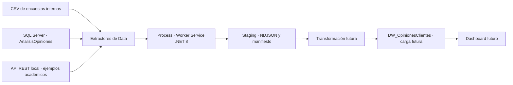
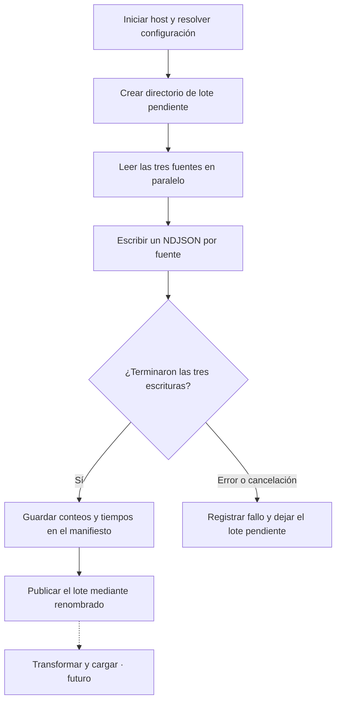

# Arquitectura y flujo de extracción

## Arquitectura de la solución

Process registra las implementaciones de `IExtractor` con DI. El Worker consume esa interfaz y entrega cada registro a `FileStaging`. La API es una fuente HTTP independiente. La consola anterior y Data comparten el lector y los tipos CSV de bajo nivel, que mantienen sus espacios de nombres. Las reglas y el escritor del ETL anterior siguen en la consola.

## Flujo de la E de ETL

## Decisiones técnicas

| Atributo | Mecanismo | Límite |
| --- | --- | --- |
| Rendimiento | I/O asíncrono, medición por fuente y total, tres tareas en paralelo con un archivo por fuente. | El lector CSV reutilizado materializa los registros. Los tiempos reflejan el conjunto académico local e incluyen escritura a staging. |
| Escalabilidad | Contrato `IExtractor`, lectura por fila en SQL y deserialización incremental de la API. | Una fuente nueva se registra en DI y necesita un identificador distinto. Si crece el número de fuentes, debe revisarse la concurrencia. |
| Seguridad | Configuración por entorno, autenticación integrada de ejemplo, `SELECT` parametrizado y `ApplicationIntent=ReadOnly`. HTTPS para servicios remotos, HTTP permitido en loopback. | La restricción efectiva de escritura depende de permisos SQL. El staging requiere permisos adecuados del sistema de archivos. |
| Mantenibilidad | Extractores, API de demostración, configuración, coordinación y staging en componentes definidos. | El contrato común conserva el esquema nativo de cada fuente para que la etapa de transformación defina su propio modelo. |
| Integridad de lotes | Escritura exclusiva por archivo y publicación tras cerrar las fuentes y guardar el manifiesto. Directorios con fecha UTC y GUID. | La reejecución conserva ambos lotes. La deduplicación entre lotes pertenece a la transformación posterior. |

El filtro SQL usa `PLATAFORMA:Web` para extraer las reseñas existentes. Los comentarios de la API se identifican individualmente como ejemplos académicos. El CSV conserva encabezados, números de línea y campos de origen. La tabla de hechos queda fuera del flujo.

## Flujo académico corregido

El diagrama incluye una API con ejemplos para la demo. En modo académico, [la API local sirve el CSV social original](Origen-Academico.md). El lote acreditado contiene 500 encuestas, 200 reseñas verificadas y 200 comentarios.
